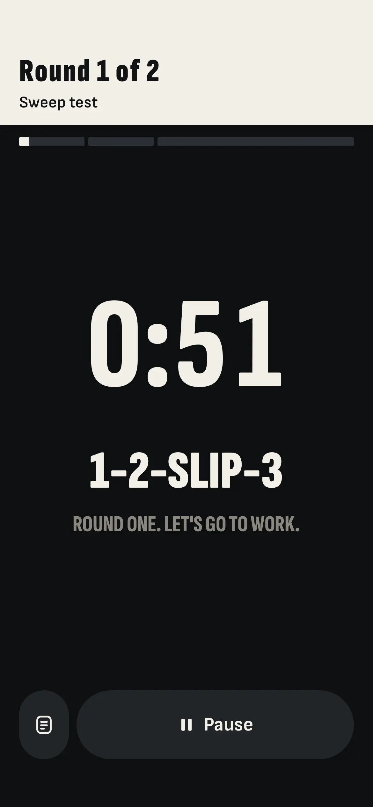
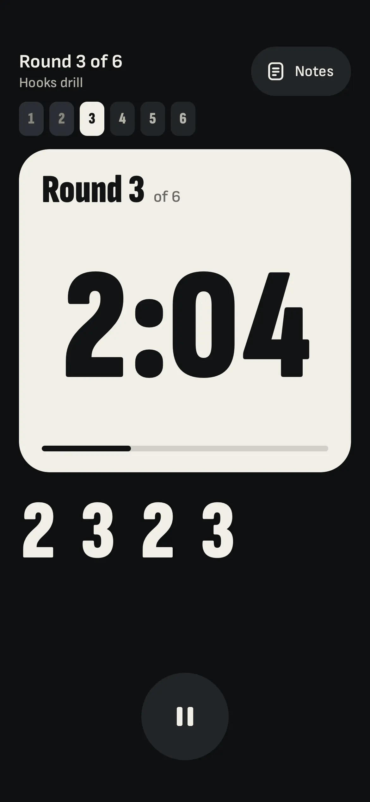
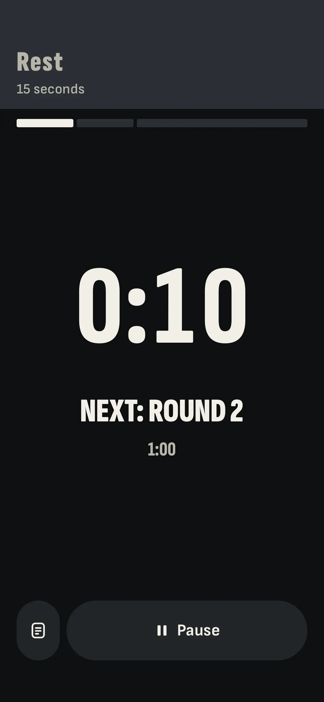
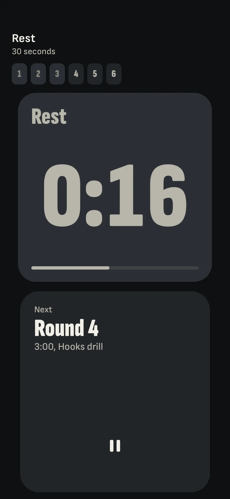

# Mitts: a product case study

**Matthew Wilson**, Staff Product Manager

**Mitts** is an iPhone boxing trainer. A coach's voice calls punch combinations ("1, 2, 3 to the body") through timed rounds, and users can build workouts and share them with a friend. No accounts, no ads, works offline, analytics opt-in.

**My role:** product owner and sole decision-maker. AI coding agents (Claude Code) do the engineering: audit, plan, build, test. I set direction and the quality bar, and I make every product call. The app's code is private; this repo shows the product work.

## Competencies shown

| Competency | Where it shows |
|---|---|
| **Diagnosis before solution** | An App Store rejection and three unexplained bugs traced to one root cause by an audit that required a reproduction test for every claim. Chose a rebuild over patching symptoms. Before release, eight intermittent test failures were each diagnosed before anything changed; no test was weakened. |
| **Scoping and prioritisation** | Sequenced the fix that blocked resubmission first, then broken screens, then the redesign. Purely visual fixes waited for the new design system, so nothing was built twice. |
| **Spec writing** | WHEN/THEN specs covering empty, offline, error, first-launch and large-text states, with the one real decision at the top in an options table. |
| **Quality bars and evals** | A versioned rubric for what the trainer says: three code-checked pass/fail gates, six scores never averaged. The AI grades alone only after matching my judgment 80% of the time, two rounds running. |
| **Directing AI agents with review gates** | A 40-task redesign, every task checked by an independent reviewer before the next began. Calls made on my behalf logged with their cost if wrong. Nothing is "done" without screenshots on two phones at two text sizes. |
| **Clear status reporting** | When a progress page left me unsure how far the build was from the approved design, I changed every status page to three columns: today, the approved design, the result. |
| **Privacy and compliance judgment** | Kept AI out of the engine to stay offline and private with no per-user cost. Analytics off until the user agrees; no advertising identifiers. Resolved the App Store rejection at its root. |
| **Data-informed iteration** | Turned a subjective goal, a coach voice that sounds natural, into targets measured from 280 real coach calls, then shipped a rebuild of all 878 voice clips behind an automated quality gate. |
| **Designing for the user's context** | A design system built for someone mid-round across the room: round and rest now differ 12 to 1 in brightness (was 1.3 to 1), with 72-point targets for gloved hands. |

## Headline decisions

| Decision | Trade-off accepted |
|---|---|
| Rebuild the training engine and replace the audio player, rather than patch | Weeks before any visible feature, in exchange for fixing the rejection and its related bugs at the root. |
| No AI model in the engine; hand-written coaching rules | Less variety in what the coach says, in exchange for offline use, privacy, no server and no per-user cost (an estimated $0.01 to $0.94 per user per month). |
| Fix all 20 UX audit findings, broken items first | A longer road to the new look, in exchange for fixing what users hit today and drawing each screen only once. |
| One "Keep coaching in the background" switch, off by default | Less fine-grained control, in exchange for predictable behaviour (iOS can't reliably tell locking the phone from switching apps). |
| Rename the product without migrating any user data | Internal names keep the old word, in exchange for zero risk to saved workouts and share links already sent. |
| Draw our own menus when iOS 26 restyled the system ones | About half a session of work, and menus no longer follow Apple's future restyles automatically. In return, menus match the approved design on every iOS version. |

## Before and after: the Card redesign

During a round, the live round is a lit card you can read from across the room. In rest the card goes dark and sits back, with the next round waiting underneath.

| Round, before | Round, after | Rest, before | Rest, after |
|---|---|---|---|
|  |  |  |  |

## Read more

| | |
|---|---|
| [case-study.md](case-study.md) | The full story: the rejection, the rebuild, the audit, the design system and its build, the rename, the voice, getting to release |
| [decisions.md](decisions.md) | Curated decision log: what was decided, why, and what it cost |
| [process.md](process.md) | How I run an AI engineering team: decision rights, specs, review, evidence |
| [examples/](examples/) | Real artifacts: a WHEN/THEN spec, a reviewed build plan, a review ledger, an evidence list, the eval rubric, the voice research |

## Status

Built and in TestFlight: the engine rebuild, the native audio player, background coaching, the audit fixes, the rename, the rebuilt coach voice and the full Card redesign. The redesign shipped to TestFlight and passed my release check on a real phone before it was merged. Left before App Store resubmission: a licence check on the logo's source photo, one more TestFlight build, and approving the App Review notes. Not yet released; nothing here claims users or revenue.
