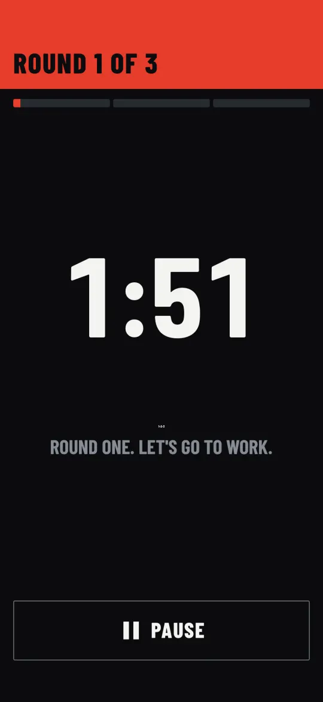
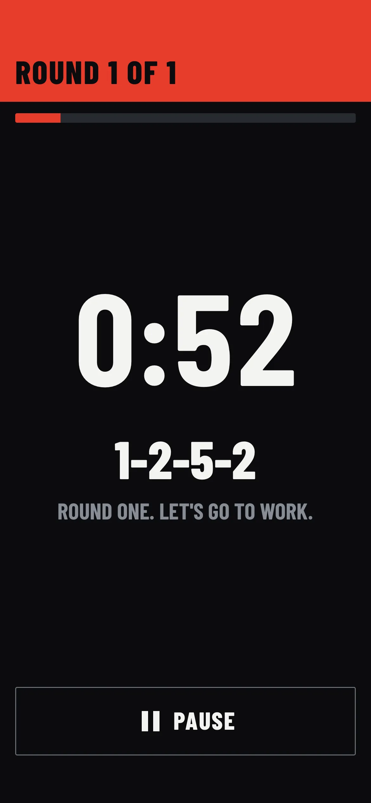
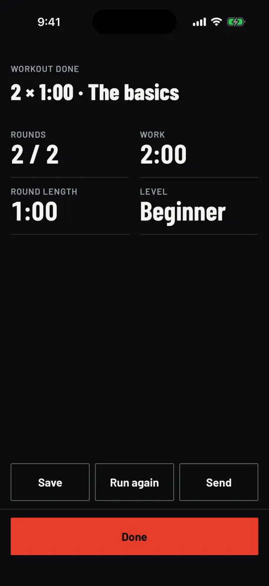
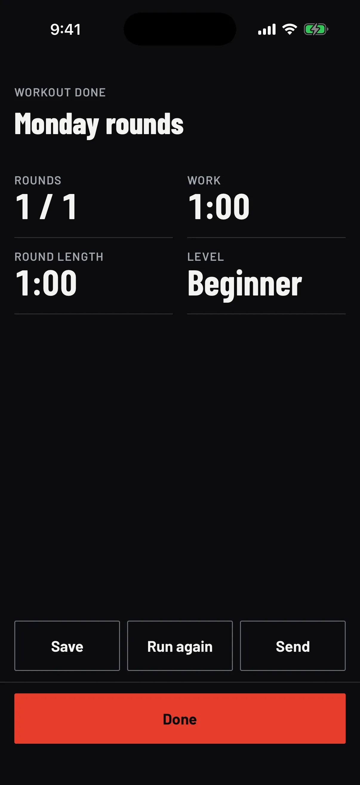
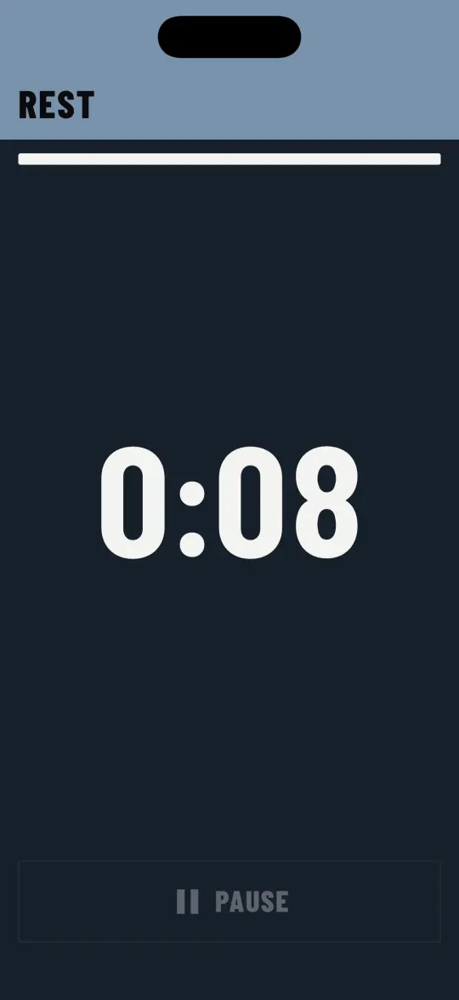
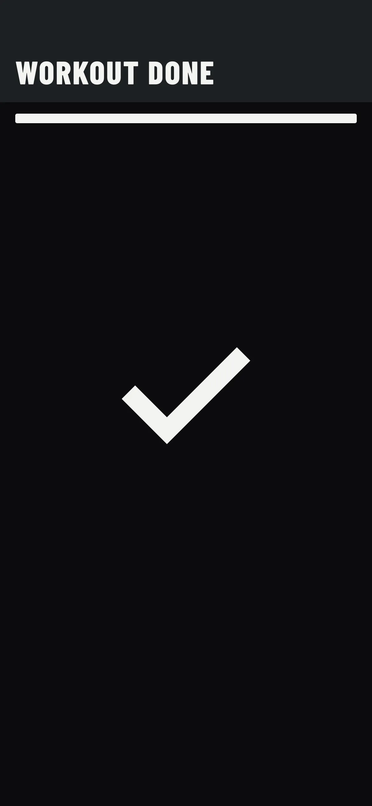
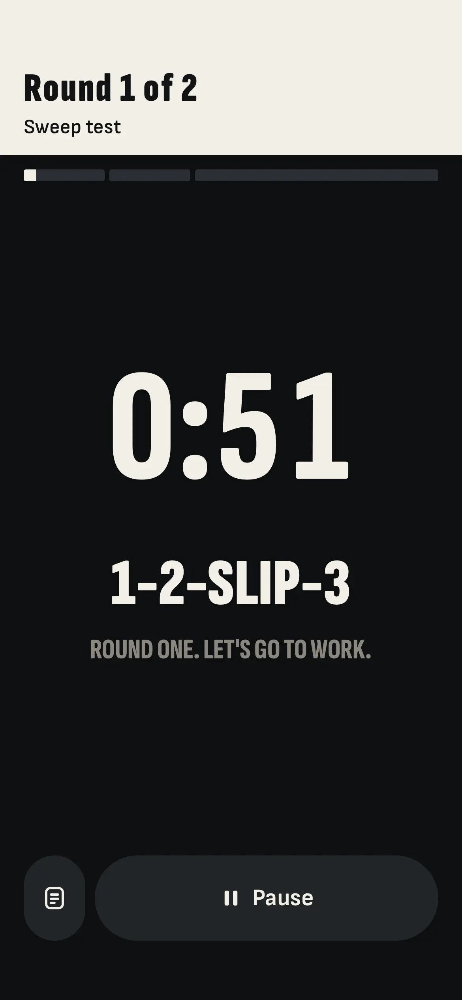
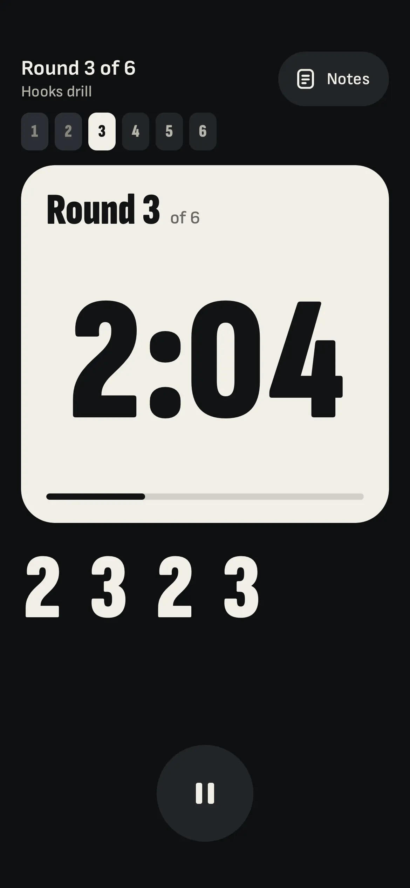
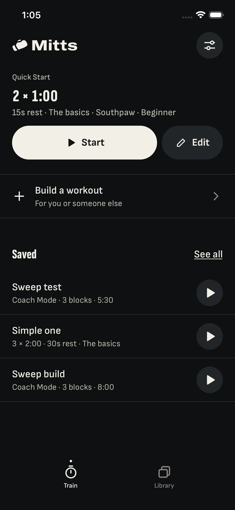
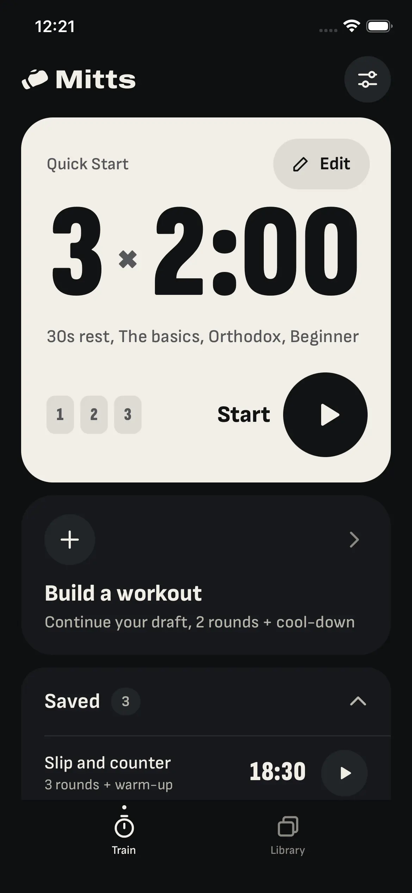

# Mitts: the case study

Mitts is an iPhone boxing trainer. You pick your rounds, put the phone down, glove up, and a coach's voice calls combinations by number ("1, 2, 3 to the body") through timed rounds, with bells, time warnings and rest. You can also build a session block by block, script exactly what each round calls, and send it to a friend as a text message. There are no accounts and no server of our own: workouts, combos and settings stay on the phone, and a workout runs with no connection.

I don't write the code. Claude Code is the engineering team: it audits, plans, builds, tests and reports. I set direction, make every product call, and decide when something is good enough. This document covers the decisions, how quality was held, and how problems were diagnosed. The full decision trail is in [decisions.md](decisions.md); the operating process is in [process.md](process.md).

Contents:

1. [The setup](#1-the-setup)
2. [The rejection, and finding the real cause](#2-the-rejection-and-finding-the-real-cause)
3. [Rebuild before repair: the engine](#3-rebuild-before-repair-the-engine)
4. [Our own audio player](#4-our-own-audio-player)
5. [A UX audit, then fixing what was broken](#5-a-ux-audit-then-fixing-what-was-broken)
6. [A new design system: Card](#6-a-new-design-system-card)
7. [The rename: Corner becomes Mitts](#7-the-rename-corner-becomes-mitts)
8. [Making the coach sound like a coach](#8-making-the-coach-sound-like-a-coach)
9. [Grading the trainer](#9-grading-the-trainer)
10. [Building Card](#10-building-card)
11. [Getting to release](#11-getting-to-release)
12. [Lessons for other PMs](#12-lessons-for-other-pms)
13. [Where it stands](#13-where-it-stands)

---

## 1. The setup

**The user.** Someone training alone: a heavy bag in a garage, shadowboxing in a living room, a gym session with no coach free to hold mitts. Solo training has a known failure mode: nobody calls the work, so you throw what you always throw, rest when you feel like it, and plateau.

**The product bet.** A coach's voice calling real combinations at a real pace beats a screen you can't look at mid-round. Hands are gloved and eyes are on the bag, so everything that matters during a round has to work by ear, from across the room.

**Product principles:**

- **Two taps to punching.** Quick Start runs your usual session from the first tab.
- **Usable with gloves on.** 72-point targets on the workout screen; nothing important hides in a small control.
- **Never silent, never robotic.** Every line the trainer can say is a pre-recorded clip in two voices. The phone's system voice is a break-glass fallback only, and a release can't ship while any line is waiting for its recording.
- **The trainer calls combos only.** Earlier versions also gave form advice between combos. Grading showed it broke the rhythm of a round more than it taught, so it was removed and archived.
- **Private by default.** Usage analytics stay off until the user agrees; crash reports are always sent, and the privacy policy says so. No advertising identifiers.

**Two early boundary decisions:**

- **No AI in the engine.** The trainer's choices are hand-written rules, not a model. A model would have cost roughly $0.01 to $0.94 per active user per month and needed a server, a connection and an extra consent step under Apple's rules. Offline and private were worth more than generative variety.
- **The code stays private; this case study is what gets shared.** The point for a reader is the product thinking, not the source.

---

## 2. The rejection, and finding the real cause

The first version was submitted to the App Store and rejected under guideline 2.5.4: the app declared background audio, and Apple didn't see it used the way that permission requires.

At the same time, three bugs from my own training had no explanation:

1. In the second workout of a session, the countdown line sometimes never played.
2. Leaving the app stopped or paused the workout, even with "keep running" switched on.
3. Locking the phone sometimes did the opposite of what the lock setting said.

The tempting move was to patch each one. Instead I commissioned an audit of the training engine before any fix, with every claim either reproduced by a failing test or traced to a specific line of code, and anything else labelled as a suspicion.

**What the audit found.** One mismatch explained the rejection and most of the bugs. The audio library switched the iPhone's audio session off 100 milliseconds after every clip; the engine assumed it stayed on for the whole workout. With audio off between combos, iOS was entitled to freeze the app in the background, so coaching died when you left the app, timers froze, and the fallback voice failed quietly too.

The audit also said what was solid. The parts deciding *what* the trainer says (combo banks, level, focus and stance rules, clip coverage) were well tested. Nearly all the bugs lived in the part deciding *when* sound comes out: a 1,295-line screen and a shared audio object with no behavioural tests. That told me the coaching rules weren't the problem; the timing and audio foundation was.

---

## 3. Rebuild before repair: the engine

**Decision: rebuild the training engine before touching audio or design.** Patching would have stacked fixes on a timer design that drifted and double-fired. The work was split into four plans, each shipping working, tested software on its own: engine core, native audio, tailored sessions, background coaching plus resubmission.

**What changed for the user:**

- The whole workout is planned up front as one timeline from one random seed, and one engine plays it on one clock. Pause, resume, rewind and restart become exact moves along that timeline.
- After the phone is locked or the app is frozen, the trainer never "catches up" with a burst of missed calls. A frozen stretch is held as a pause.
- If the app crashes mid-workout, the next launch offers to resume from the exact spot, replaying the same combos.

**Decisions inside the rebuild:**

- **One "Keep coaching in the background" switch, off by default,** covering both locking the phone and switching apps. iOS can't reliably tell those apart, so two switches would misfire. One predictable switch beats two unreliable ones.
- **Music is lowered for the whole workout** rather than dipping for every line. Constant dipping is more distracting than a steady lower level.

**How quality was held.** Every past bug became an automated test. Randomised tests run hundreds of simulated workouts full of pauses, locks, rewinds and crashes, checking rules that must always hold (the round's start bell never rings twice; work time counts once). Each task was built by one agent and checked by a fresh reviewer before the next began. On the day that rule was adopted, the reviewer caught a bug that would have silenced the count-in.

---

## 4. Our own audio player

**Decision: a native iPhone audio player of our own, playing the existing recorded voice.** This fixes the 2.5.4 cause at the root instead of working around a library. The voice doesn't change.

The plan put every behaviour a user would notice in front of me as a decision, each with a recommendation and a cost:

| Situation | Decision | Cost accepted |
|---|---|---|
| Paused on screen | Nothing plays; music stays lowered | A long pause keeps music low until resume or stop |
| A phone call, Siri or an alarm | The workout pauses until the user taps Resume | After Siri on a locked phone, the user unlocks to resume |
| Headphones disconnect | The workout pauses | One tap to continue on the speaker, instead of combos suddenly blaring from the phone |
| Bluetooth delay (about 0.2 s on AirPods) | Measure first; correct only if noticeable | Until then, a call can show on screen a moment before it's heard |

Engineering calls made during the build were logged as **rulings**, each with its cost if wrong. Two examples:

- A line whose recording isn't ready within 1.5 seconds of its moment is skipped, not spoken late. A late call is worse than a missed one.
- Every line is scheduled 50 ms ahead instead of 10. Shorter leads started lines late without the delay log showing it; 40 ms is inaudible.

The final whole-branch review returned "with fixes" (a configuration change could cut off a live line; USB-C headphones unplugging weren't detected; two user-facing rulings were missing from the decision log). All were fixed and re-reviewed clean. Minor findings not worth fixing yet were recorded with the reason. Excerpt: [examples/review-ledger-native-audio.md](examples/review-ledger-native-audio.md).

---

## 5. A UX audit, then fixing what was broken

Two problems I found by hand (four button sizes in three styles on the end screen; an empty Saved section showing a bare heading) suggested there were more. So before any more design work:

1. Every screen and state was captured in the simulator.
2. Each was audited against Apple's guidelines and the app's own bar: two taps to punching, usable with gloves on.
3. I marked each finding Fix, Skip or Later.
4. Anything big came to me as a mockup before code. An earlier redesign had gone straight to code and been rejected; that cost wasn't worth paying twice.

**Result: 20 findings, all marked Fix,** including six polish items. Three were must-fix: the end-screen buttons, the empty Saved state, and a pre-filled name longer than the 20-character limit that froze the text box.

**Sequencing was a product decision.** Broken things were fixed first, in the current look. Purely visual findings waited for the new design system, so nothing would be drawn twice.

**A second, design-focused audit (121 captures) found something worse.** On standard 390-point iPhones (most current models), the live combo call, the most important thing on the workout screen, shrank to a speck a few points tall. My own phone at normal text was fine, which is why it never appeared in my testing. The cause was a text-shrinking setting the iPhone silently ignores under the framework's new architecture. The fix replaced shrink-to-fit everywhere with sizes chosen from the text's length, and a test now forbids shrink-to-fit anywhere in the app.

| Before | After |
|---|---|
|  |  |

*The live call on a 390-point iPhone. The screens in this section predate the rename and the Card redesign; [section 10](#10-building-card) shows the redesigned app.*

**Batch A** fixed the broken things: the speck, over-long automatic names, the screen saying "Rest" after the final bell, toasts covering buttons, and five small bugs found while capturing. It started with a WHEN/THEN spec covering offline, first launch and large text, with one decision for me at the top: [examples/spec-batch-a.md](examples/spec-batch-a.md).

That decision was what to call a workout nobody named. Three options were shown with real examples: the day ("Sunday rounds"), the focus ("Basics workout") or shorter numbers ("2 × 1:00, Basics"). I chose the day: it never repeats the summary line printed under the name, and it follows how leading fitness apps name an unnamed run. Cost: two workouts saved on the same weekday share a name until one is renamed.

| Before | After |
|---|---|
|  |  |

After the final bell, the screen used to say "Rest" and count down the coach's sign-off. Now it says "Workout done", with a tick heavy enough to read from two or three metres:

| Before | After |
|---|---|
|  |  |

**Evidence before "done".** Every changed screen was captured on two phones (a large one and a 390-point one) at normal and largest text. Automated tests went from 704 to 789 passing. Every existing test that changed was listed with the reason; none was weakened. The evidence list also named what still looked wrong. Excerpt: [examples/evidence-batch-a.md](examples/evidence-batch-a.md).

---

## 6. A new design system: Card

After the audit mockups, I concluded the existing look wasn't worth polishing screen by screen and commissioned a new design system from scratch.

**How the direction was chosen.** Every direction already rejected was ruled out first, so review time wasn't spent on near-copies. Seven fresh starting points from boxing culture were drawn up, and one was picked at random so the proposal wouldn't default to the most obvious idea. The pick was the round card: the number raised between rounds so the whole room knows where the fight is.

**What Card does.** The live round is a lit card; rest is the card going dark; warm-ups are a warmer lit card; red means stop or error and nothing else. From three metres, peripheral vision reads brightness far better than colour. In the old look, round and rest differed by 1.3 to 1 in brightness; Card's lit and dark cards differ by 12 to 1. Cost, named up front: a lit card uses more battery and can glare in a dark garage, so it follows the phone's brightness and is never pure white.

**Approving the look surfaced a gap in the words.** With the visual design approved, I asked whether the copy and popups had been reviewed from a boxer's point of view. They hadn't: every line had been carried over from the old app. So every screen was walked as two personas (two years in, mid-session on a heavy bag with gloves on; a few months in, opening a friend's workout), then checked against Apple's writing guidance. About 30 wording changes and seven behaviour changes came back as one approval. For example, saving a combo mid-workout became one tap with no name to type, and the paused screen now says *why* it paused.

That review also caught an error in an earlier rule: "safe choice on top" in popups was the opposite of Apple's guidance. It was corrected and logged as a correction.

**The build plan.** The Card build is a 40-task plan in seven phases, written by one agent and reviewed and revised by another before it reached me. An iPhone SE check found the current app already breaks on the SE's shorter screen with very long combos; those findings became requirements. The plan opens with the five questions only I could answer, each with a recommendation and what yes and no would mean. I approved all five recommendations. Excerpt: [examples/plan-card-build.md](examples/plan-card-build.md). How the build went is in [section 10](#10-building-card).

---

## 7. The rename: Corner becomes Mitts

The app was called Corner. An App Store check turned up an app already called "Corner" in Health & Fitness, plus several boxing apps with Corner in the name. **I decided to rename** so the app could be found and remembered without confusion.

**Naming criteria.** A phrase boxers already use in the gym, tied to what the app does, not an invented compound word. Each candidate was checked against the App Store and a web search. I rejected the first shortlist (Touch Gloves, Stick and Move, Stay Busy, On the Pads) because they read as coaching instructions rather than names, and redirected toward short brand words.

**Mitts.** "Let's do mitts" is what boxers call the session where a coach holds focus mitts and calls combos, which is what the app does without the coach there. One short word, written with a capital M so it reads athletic rather than playful.

**The logo took more rounds than anything else.** Freehand glove drawings kept reading as other objects (an oven mitt, a chef's hat). After four rounds I scrapped the work and reset the brief: a typeface that is serious rather than playful, and a glove grounded in research on what real boxing gloves look like. The next approach traced the outline of a real glove photographed side-on, with a type-only fallback agreed in advance. It was the first one that read as a boxing glove. I kept the logo off the critical path: app work continued in parallel with a placeholder wordmark.

When the first icon reached a phone, iOS 26 added its own glass shading and turned the glove grey with a halo, off-brand. It was redrawn as the same glove in bone on the app's black, and iOS is told to leave it flat. Logged lesson: check what the OS does to an icon before it ships to a device.

**What changed and what deliberately didn't.** Everything a user sees says Mitts, and the "My Corner" tab became Library, the word iPhone users already know. Everything users never see kept the old name on purpose: stored data, the App Store identity, the share-code format, internal names. New share links use the new name; links already sent keep working. Nothing was migrated, so nothing could be lost. Existing users accept the updated Terms once but aren't asked their stance (orthodox or southpaw) again. A test fails if the old name returns to on-screen text.

---

## 8. Making the coach sound like a coach

After a listening session I reported two problems: the voice sounded scratchy, and the delivery didn't sound like a coach. The investigation treated them separately.

**The scratch** was traced to the voice engine's own output. Against coaches' recordings, its hiss on "t", "th" and breaths was roughly twice as loud to the ear, it added a faint whine at three fixed pitches, and the male voice's vowels were raspier. The app's audio player, the file quality and earlier processing were each ruled out.

**The delivery** was the harder question: what does "natural" mean for a combo call? I set the direction: measure how human coaches call combos, match that, and rebuild every clip only once we agreed the result was more natural.

The research measured 280 calls from nine coaches in public coaching videos, used only as a measuring stick, never as audio. Coaches keep every number nearly level, with even loudness and almost no gap between items, and end level or falling, almost never rising like a question. Our voice did the opposite: it read combos like a list, starting high, stepping down, fading, with long pauses. Candidate methods were scored against the coach pattern before anyone listened. Reshaping the natural recording to the coaches' pitch pattern came out closest; a newer open-source voice model said the wrong words in 11 of 40 takes and was dropped. Summary: [examples/voice-research.md](examples/voice-research.md).

**Then the ear took over.** Seven listening rounds followed, each a page of side-by-side samples. Each piece of feedback was traced to a measurable cause before it was fixed:

- **Short combos didn't end high.** The engine dropped its pitch sharply on the last word of every call, regardless of punctuation; the earlier fix had only softened it.
- **Different lengths wanted different endings.** One round suited combos of three or more punches, another suited two or fewer, so the ending rule became length-dependent.
- **Two-punch combos climbed artificially instead of stressing the second punch.** They switched to stress (louder and longer on the second punch). A timing fault in the word-boundary tool, placing some words up to 60 ms early, explained why emphasis had landed on the wrong number.
- **The female voice sounded robotic.** Measured, not guessed: the previous round had squeezed her natural pitch movement to under half and made her vocal vibration unnaturally even (jitter 1.3 to 1.7 percent against a natural 2.1 to 2.6). Round 7 restored both.
- A well-known neural audio tool was tried to remove the rasp. It reproduced the rasp exactly and was dropped.

**Outcome: shipped.** I approved round 7 for both voices. Every line was rebuilt in both voices (878 clips) behind an automated quality gate: a word-accuracy check by speech recognition, glitch and robotic-jitter checks, loudness checks, and emphasis on the final punch. Any clip that failed fell back to its natural recording rather than shipping a bad version, and every fallback was listed. The rebuilt voice is in the test build.

---

## 9. Grading the trainer

"The coaching feels off" isn't a bug report. To make it one, the trainer is graded against a written rubric, now on version 2: [examples/eval-rubric.md](examples/eval-rubric.md).

- **What gets graded:** a timestamped transcript of everything the trainer says for one setup (level, stance, focus, mode), from a fixed list of setups and seeds, so a session can be re-run after a fix and compared line for line.
- **Three pass/fail gates, checked by code:** every line has a recording; no product rule is broken (for example, the trainer's own combos never slip toward the opponent's power hand); every round has the right skeleton.
- **Six scores, never averaged.** A session scoring 5/5/1/5/5/5 has a variety problem; an average of 4.3 would bury it.
- **Who judges:** code scores everything with a right answer. The AI proposes judgment calls (pacing, whether a line sounds like a real cornerman) with a one-line reason each. I have the final word.
- **Trust is earned with a number:** the AI grades alone only after matching me on at least 80 percent of tags, and within one point on 80 percent of scores, for two rounds running.
- **Every judgment I make that code could have made becomes a new code check,** so the rubric keeps hardening into automated tests.

Grading changed the product directly: beginners never throw the same hand twice in a row (the double jab aside), lines no cornerman would say were cut, and the advice lines between combos were removed.

---

## 10. Building Card

The plan ran as written: 40 tasks in seven phases over five days. One agent built each task and a fresh reviewer checked it before the next began, and a whole-branch review closed the build. Each phase ended with screenshots of every changed screen on two phones (an iPhone 16e and the smaller iPhone SE) at normal and largest text, plus a list of every call made on my behalf.

| Round, before | Round, after | Train, before | Train, after |
|---|---|---|---|
|  |  |  |  |

**The status page that misled me.** After Phase 2 I opened the progress page expecting redesigned screens and saw what looked like rounder buttons. Phase 2 had only replaced the parts that screens are built from; the redesigned screens were due in Phases 3 to 6. The build was on track, but a before-and-after page hid how far it still was from what I'd approved. From then on, every status page showed three columns: today, the approved design, the result. I also chose which screen to rebuild first: the workout screen, the biggest change and where people spend the most time.

**Changes I asked for mid-build were drawn before they were built.**

- **Train.** Quick Start and Build a workout became large tappable cards, a tap anywhere on Quick Start starts it, and Saved folds away below and remembers how you left it. It was mocked, approved through three asks, and built into its phase. Cost: about half a day.
- **A way back out of a mistaken start.** During the Get ready countdown, a back arrow returns to Train with no popup, because nothing has been trained yet. It fades at the first bell. I asked for a little more room around it on the mock before approving.
- **Not everything needs a mock.** Quick Start's editor now ends in "Save and start" and "Start", so changed settings can run once without overwriting Quick Start. Two standard buttons, low risk: built directly.

**The platform moved under the design.** iOS 26 redrew the iPhone's own menus as a small floating box with no Cancel button, not the bottom sheet the approved design draws. I chose to draw our own sheet, the same on every iOS version. Cost: about half a session, and the menus no longer follow Apple's future restyles automatically.

**Bugs found along the way.** A Coach Mode workout with about two full rounds of long combos made a share code that the friend's app refused, because of an old 4,000-character cap. The cap is now 100,000, enough for the largest workout the app allows. Cost: a friend on an older build has to update before adding one of those big workouts. Deleting also changed: anything you delete goes at once and a toast offers Undo, which puts it back exactly where it was. Before, a popup asked first.

**Accessibility held to numbers, not taste.**

- Two small labels on the workout screen were drawn in the approved design at 3.8:1 and 3.4:1 contrast. I approved lightening both to 5:1: small text under 4.5:1 is hard to read mid-round.
- Every screen was checked at the largest text size on both phones. Nothing shrinks to fit, lines that would push content off screen sit closer together, and long popups scroll as one so nothing is cut off.
- VoiceOver reads a long call as "Slip right", not "Slip R", and on the paused screen it reads why the workout paused before the Restart button.

**A risk accepted with a condition.** The glove logo was traced from a freely licensed photo, and that licence may require a credit. The recommendation was to retrace it from my own photo. I chose to keep the logo and have the licence checked by someone qualified before the public release. Test builds aren't affected, so the check blocks nothing until then.

**On a real phone before merging.** The redesign stayed on its own branch until a TestFlight build passed my release check on my phone: clean install, permissions allowed and denied, airplane mode, lock and unlock, headphones, the silent switch, large text, and force-quit and reopen. It passed, and the redesign was merged. Automated tests went from 789 after Batch A to about 2,000. The ten tap-through flows (Maestro) couldn't run on the new simulators for most of the build. They were fixed in the last phase and now pass on both phones.

---

## 11. Getting to release

With the redesign merged, one session went to the unglamorous last stretch: intermittent test failures and housekeeping.

**Intermittent failures, diagnosed one by one.** Three tests failed now and then; the worst failed about one run in five. The tempting move is to loosen the check or re-run until it's green. The rule was the opposite: diagnose each failure before changing anything, never weaken a test, and prove the fix with numbers.

- **In every case the app was right.** Each test expected something stricter than the approved behaviour, which showed only on a rare random draw. Example: when the phone froze the app at the exact moment a round began, rewinding to the round's first combo correctly rang the start bell first, because it had never rung, and then called the combo. The test expected the combo first.
- **Each fix kept the check at least as strict.** The failing case became its own named test, so it runs the same way every time, and any future random failure can now be replayed exactly.
- **Proving the fix found five more.** So the whole test suite was run under 400 different random seeds, and all five were fixed the same way. All 400 seeds pass now, along with 2,000 simulated workouts and five full runs back to back.

**Debugging surfaced a product gap. It came to me as a question, not a fix.** Some of the trainer's own combos include footwork the combo builder doesn't offer, such as "circle out". Those combos can't appear in the paused screen's list, so they can't be rewound or saved. It's existing behaviour, not a regression, so it came to me as a decision with a recommendation: show them with Rewind only, after release, with a spec and a mock first. It didn't come as a quiet change.

**Housekeeping with effects a user or reviewer would see:**

- An old notifications package, kept only to clean up after a retired reminder feature, was removed once testers had run that cleanup. The app no longer carries a push-notification capability it doesn't use.
- The build upload went from 1.4 GB to 49 MB by leaving design and research files out of it.
- App Review notes are drafted. They explain what makes Mitts more than a timer (the guideline that rejects look-alike apps in crowded categories) and how a reviewer can test coaching with the phone locked.

**A slip, owned.** A documentation-only save went out alongside a test run that then failed. No app code was affected, but it broke the rule that every save waits for the type check and the tests. It was reported in the next status update along with the fix: a save always waits for the result.

---

## 12. Lessons for other PMs

- **Diagnose before you prescribe.** The rejection looked like a paperwork problem. It was one library behaviour that also explained three bugs. A day of auditing saved weeks of patching symptoms.
- **Make every decision cheap to review.** Every ask comes with a recommendation, where to look, and what yes and no each mean. Every call made on my behalf is logged with its cost if wrong, so it can be reversed in one sentence.
- **Separate what I decide from what the team decides.** Inside an approved scope, the team decides and logs. Anything that changes what a user sees, hears or pays comes to me.
- **Independent review is the safety net.** The builder never grades its own work.
- **Evidence over assertion.** Screenshots on two phones at two text sizes, test counts before and after, and a list of what still looks wrong.
- **Test on real conditions, not your own device.** The worst bug of the project was invisible on my phone and broken on most others.
- **Name the cost of every decision.** A decision with no stated cost hasn't been thought through.
- **Show the target beside the result.** A before-and-after page can look like progress, or like a lack of it. Putting the approved design in the middle column shows exactly how far there is to go.
- **An intermittent failure is a bug until proven otherwise.** Re-running until it's green hides it. Diagnosing it showed the app was right, and the stricter tests now protect it.
- **Engineering finds product gaps; the PM decides them.** A gap found while debugging comes back as a question with a recommendation, not a quiet change.

---

## 13. Where it stands

- The engine rebuild, the native audio player and background coaching are built and tested.
- The UX audit's broken items (Batch A), the rename to Mitts and the rebuilt coach voice in both voices are built.
- The Card redesign is built and passed my release check on a TestFlight build, then was merged.
- The release scans pass: no placeholder text, no dead buttons, and every line the trainer can say has a recording.
- Left before App Store resubmission: the logo licence check, one more TestFlight build, and my approval of the App Review notes.

The app isn't released yet. Nothing in this repo claims users, ratings or revenue.
